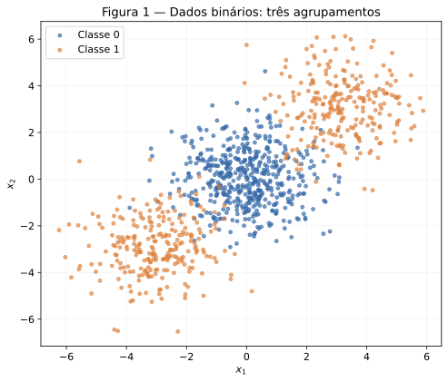
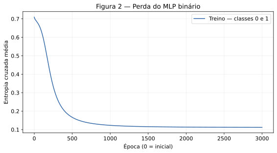
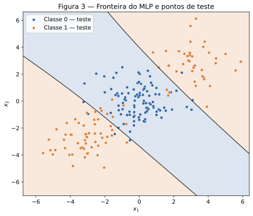
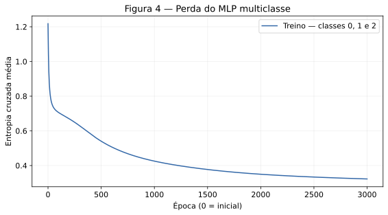
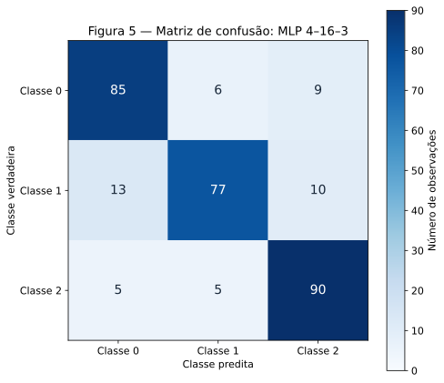
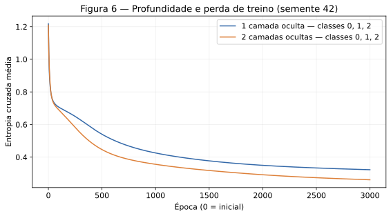

# MLP — Multi-Layer Perceptrons

**Gabriel Gerner Maggion · Insper · Artificial Neural Networks and Deep Learning · 2026.2**  
**Data:** 13 de outubro de 2026.

O objetivo é entender como a camada oculta modifica as regiões de decisão e verificar o efeito de aumentar a profundidade. As redes foram implementadas em NumPy, incluindo ativações, perdas, propagação, gradientes e atualização. Os números abaixo são resultados das execuções, sem selecionar sementes pelo desempenho no teste.

**Fontes:** [enunciado da atividade](https://insper.github.io/ann-dl/2026.2/exercises/mlp/) e [formato de entrega](https://insper.github.io/ann-dl/2026.2/exercises/submission/), consultados em 13/10/2026. **Uso de IA:** OpenAI ChatGPT/Codex participou da resolução, código, verificações, figuras, redação e publicação, conforme declarado no campo `ai_use`.

**Reprodução:** na raiz do repositório, executar:

```bash
python -m pip install -r docs/exercises/mlp/code/requirements.txt
python docs/exercises/mlp/code/mlp.py
```

O script recria as seis figuras, [os resultados numéricos](code/results.json) e [a comparação das sementes](code/seed_comparison.csv). Ambiente usado: Python 3.12.14, NumPy 2.3.5, pandas 2.2.3, Matplotlib 3.10.8 e scikit-learn 1.8.0. Existe um único gerador `rng = np.random.default_rng(42)`. Nas repetições pareadas do Exercício 4, seu estado é reiniciado com 42, 43 e 44; os dados e sua divisão permanecem fixos em 42. O mesmo objeto `rng` é passado a todas as redes.

## Exercise 1

### A — Forward pass

Neste exercício, cada linha de $W^{(1)}$ corresponde a um neurônio oculto. Com $x=[0.5,-0.2]^T$ e $y=1$, as pré-ativações são:

$$
z_1^{(1)}=0.3(0.5)+(-0.1)(-0.2)+0.1
=0.150000+0.020000+0.100000=0.270000,
$$

$$
z_2^{(1)}=0.2(0.5)+0.4(-0.2)-0.2
=0.100000-0.080000-0.200000=-0.180000.
$$

Aplicando $\tanh$:

$$
h_1=\tanh(0.270000)=0.26362484,\qquad
h_2=\tanh(-0.180000)=-0.17808087.
$$

Na saída:

$$
u^{(2)}=0.5h_1-0.3h_2+0.2
=0.13181242+0.05342426+0.20000000=0.38523668.
$$

$$
\hat y=\tanh(0.38523668)=0.36724656.
$$

Como existe uma única observação, não há fator adicional de média:

$$
L=(1-0.36724656)^2=(-0.63275344)^2=\boxed{0.40037691}.
$$

### B — Backward pass

A regra da cadeia começa na perda. Não se usa o fator $1/2$, pois ele não aparece no enunciado:

$$
\frac{\partial L}{\partial\hat y}=2(\hat y-y)
=2(0.36724656-1)=-1.26550687.
$$

A derivada da ativação de saída é:

$$
\frac{\partial\hat y}{\partial u^{(2)}}=1-\hat y^2
=1-(0.36724656)^2=0.86512996.
$$

Logo, o delta da saída é:

$$
\delta^{(2)}=\frac{\partial L}{\partial u^{(2)}}
=(-1.26550687)(0.86512996)=\boxed{-1.09482791}.
$$

**Pesos e viés da saída.** Como $u^{(2)}=W^{(2)}h+b^{(2)}$:

$$
\frac{\partial L}{\partial W_1^{(2)}}=\delta^{(2)}h_1
=(-1.09482791)(0.26362484)=-0.28862383,
$$

$$
\frac{\partial L}{\partial W_2^{(2)}}=\delta^{(2)}h_2
=(-1.09482791)(-0.17808087)=0.19496791,
$$

$$
\frac{\partial L}{\partial b^{(2)}}=\delta^{(2)}=-1.09482791.
$$

**Gradientes que chegam às ativações ocultas.** São usados os pesos antigos, antes de qualquer atualização:

$$
\frac{\partial L}{\partial h_1}=\delta^{(2)}W_1^{(2)}
=(-1.09482791)(0.5)=-0.54741396,
$$

$$
\frac{\partial L}{\partial h_2}=\delta^{(2)}W_2^{(2)}
=(-1.09482791)(-0.3)=0.32844837.
$$

As derivadas das ativações ocultas são:

$$
1-h_1^2=0.93050195,\qquad 1-h_2^2=0.96828720.
$$

Portanto:

$$
\delta_1^{(1)}=\frac{\partial L}{\partial z_1^{(1)}}
=(-0.54741396)(0.93050195)=-0.50936975,
$$

$$
\delta_2^{(1)}=\frac{\partial L}{\partial z_2^{(1)}}
=(0.32844837)(0.96828720)=0.31803236.
$$

**Pesos e vieses ocultos.** Para cada peso, $\partial L/\partial W_{ij}^{(1)}=\delta_i^{(1)}x_j$:

$$
\begin{aligned}
\frac{\partial L}{\partial W_{11}^{(1)}}&=(-0.50936975)(0.5)=-0.25468488,\\
\frac{\partial L}{\partial W_{12}^{(1)}}&=(-0.50936975)(-0.2)=0.10187395,\\
\frac{\partial L}{\partial W_{21}^{(1)}}&=(0.31803236)(0.5)=0.15901618,\\
\frac{\partial L}{\partial W_{22}^{(1)}}&=(0.31803236)(-0.2)=-0.06360647.
\end{aligned}
$$

$$
\frac{\partial L}{\partial W^{(1)}}=
\begin{bmatrix}-0.25468488&0.10187395\\0.15901618&-0.06360647\end{bmatrix},
\qquad
\frac{\partial L}{\partial b^{(1)}}=
\begin{bmatrix}-0.50936975\\0.31803236\end{bmatrix}.
$$

### C — Parameter update

Cada parâmetro recebe $\theta_{\mathrm{novo}}=\theta_{\mathrm{antigo}}-0.3\,\partial L/\partial\theta$. A tabela mostra todas as substituições. O texto do enunciado menciona oito parâmetros, mas os valores fornecidos contêm **nove escalares**: quatro pesos ocultos, dois vieses ocultos, dois pesos de saída e um viés de saída.

| Parâmetro | Atualização com $\eta=0.3$ | Valor novo |
|---|---|---:|
| $W_{11}^{(1)}$ | $0.30000000-0.3(-0.25468488)$ | 0.37640546 |
| $W_{12}^{(1)}$ | $-0.10000000-0.3(0.10187395)$ | -0.13056219 |
| $W_{21}^{(1)}$ | $0.20000000-0.3(0.15901618)$ | 0.15229515 |
| $W_{22}^{(1)}$ | $0.40000000-0.3(-0.06360647)$ | 0.41908194 |
| $b_1^{(1)}$ | $0.10000000-0.3(-0.50936975)$ | 0.25281093 |
| $b_2^{(1)}$ | $-0.20000000-0.3(0.31803236)$ | -0.29540971 |
| $W_1^{(2)}$ | $0.50000000-0.3(-0.28862383)$ | 0.58658715 |
| $W_2^{(2)}$ | $-0.30000000-0.3(0.19496791)$ | -0.35849037 |
| $b^{(2)}$ | $0.20000000-0.3(-1.09482791)$ | 0.52844837 |

Repetindo o cálculo com esses parâmetros:

$$
z_{1,\mathrm{novo}}=0.37640546(0.5)+(-0.13056219)(-0.2)+0.25281093=0.46712609,
$$

$$
z_{2,\mathrm{novo}}=0.15229515(0.5)+0.41908194(-0.2)-0.29540971=-0.30307852,
$$

$$
h_{\mathrm{novo}}=[0.43587433,-0.29412735]^T,
$$

$$
u_{\mathrm{novo}}=0.58658715(0.43587433)-0.35849037(-0.29412735)+0.52844837
=0.88956848,
$$

$$
\hat y_{\mathrm{novo}}=0.71118053,\qquad
L_{\mathrm{novo}}=(1-0.71118053)^2=\boxed{0.08341669}.
$$

A perda **cai de 0.40037691 para 0.08341669** e a previsão se aproxima do alvo 1. O negativo do gradiente aponta a direção de redução local da perda; neste caso o passo de 0.3 efetivamente reduz o erro. Isso foi confirmado pela segunda propagação, pois uma taxa excessiva não garantiria redução em uma rede não linear. Os cálculos usam precisão completa; o arredondamento ocorre apenas na apresentação.

## Exercise 2

### A — Generate the data

Foram gerados 1.000 pontos com `make_blobs`: 500 ao redor de $(0,0)$, 250 ao redor de $(3,3)$ e 250 ao redor de $(-3,-3)$, com desvio 1.2 e `random_state=42`. A classe 0 é o agrupamento central e a classe 1 reúne os dois extremos. A divisão estratificada 80/20 produz **800 observações de treino (400 por classe)** e **200 de teste (100 por classe)**.

A Figura 1 mostra todos os pontos em suas coordenadas originais. Para treinar os modelos, cada atributo é padronizado por $\tilde x_j=(x_j-\mu_j)/s_j$. A média e o desvio são calculados somente no treino e depois aplicados ao teste e à grade de decisão.



### B — Establish the baseline

A regressão logística utiliza os mesmos dados padronizados de treino, configuração padrão de regularização, `max_iter=2000` e `random_state=42`. Sua acurácia no teste foi **47,50% (95/200)**. Trata-se do baseline linear permitido pelo enunciado, não da implementação da MLP.

### C — Implement the MLP

A arquitetura escolhida foi **2 → 8 → 1**, com **33 parâmetros**, `tanh` na camada oculta e sigmoide na saída. Foram realizadas **3.000 épocas**, taxa **0.1**, gradiente descendente com todas as 800 observações em cada atualização, inicialização Xavier uniforme e vieses inicialmente iguais a zero. Não foram usados momentum, regularização, dropout ou parada antecipada.

A acurácia no teste foi **92,00% (184/200)**. A entropia cruzada binária média caiu de **0.70951841** para **0.11215330** no treino. O limiar de classificação é 0.5.

**Equações implementadas.** No código, as observações ocupam as linhas; por isso $W$ tem formato entrada × saída, transposto em relação à convenção do Exercício 1. Para um lote de $N$ exemplos:

$$
A^{(0)}=X,\qquad Z^{(l)}=A^{(l-1)}W^{(l)}+b^{(l)},\qquad
A^{(l)}=\tanh(Z^{(l)})\quad\text{nas camadas ocultas}.
$$

Na saída binária, $P=\sigma(Z^{(L)})$ e:

$$
\mathcal L=-\frac1N\sum_{i=1}^N[y_i\log p_i+(1-y_i)\log(1-p_i)].
$$

A regra da cadeia dá:

$$
\frac{\partial\mathcal L}{\partial p_i}
=\frac1N\left(-\frac{y_i}{p_i}+\frac{1-y_i}{1-p_i}\right),\qquad
\frac{\partial p_i}{\partial z_i}=p_i(1-p_i),
$$

$$
\Delta^{(L)}=\frac{\partial\mathcal L}{\partial Z^{(L)}}=\frac{P-Y}{N}.
$$

Para qualquer camada, inclusive com várias camadas ocultas:

$$
\frac{\partial\mathcal L}{\partial W^{(l)}}=(A^{(l-1)})^T\Delta^{(l)},\qquad
\frac{\partial\mathcal L}{\partial b^{(l)}}=\sum_i\Delta_i^{(l)},
$$

$$
\Delta^{(l-1)}=
\big[\Delta^{(l)}(W^{(l)})^T\big]\odot\big[1-(A^{(l-1)})^2\big].
$$

A atualização é $W\leftarrow W-\eta\,\partial\mathcal L/\partial W$ e $b\leftarrow b-\eta\,\partial\mathcal L/\partial b$. Todos os gradientes são calculados antes de modificar os parâmetros. Para evitar problemas numéricos, a BCE é avaliada diretamente dos logits com `logaddexp`, sem alterar a fórmula de seu gradiente.





As regiões coloridas representam a classe prevista; os pontos representam as classes verdadeiras do teste. A linha escura marca a probabilidade 0.5. A época 0 das curvas representa o modelo antes do treinamento, seguida pelas 3.000 atualizações.

**Código executável e comentado — implementação única dos Exercícios 2, 3 e 4.** [Baixar `mlp.py`](code/mlp.py). O arquivo abaixo é incluído diretamente do código versionado. Os métodos `forward`, `backward` e `update` não são redefinidos entre os exercícios.

```python
--8<-- "docs/exercises/mlp/code/mlp.py"
```

A verificação por diferenças finitas centrais compara os gradientes analíticos de todos os parâmetros de três redes pequenas: binária, multiclasse e multiclasse com duas camadas ocultas. Os maiores erros absolutos foram, respectivamente, **7.95 × 10⁻¹¹**, **1.27 × 10⁻¹⁰** e **1.08 × 10⁻¹⁰**, abaixo da tolerância $10^{-7}$. Essa conferência não participa da otimização e restaura o estado do gerador aleatório.

### D — Analysis

A Figura 3 mostra a classe 1 em **duas regiões externas, em lados opostos da faixa central atribuída à classe 0**. Uma única reta divide o plano em dois semiplanos: não consegue colocar ambos os extremos na classe 1 e deixar o agrupamento central na classe 0. A camada oculta combina transformações não lineares e produz as duas transições necessárias.

Há aproximadamente uma simetria entre os dois agrupamentos da classe 1. Assim, a direção linear que ajuda a classificar um extremo tende a prejudicar o outro, e a regressão logística encontra pouco sinal linear aproveitável. O valor de **47,50%** fica próximo dos 50% esperados de um palpite aleatório balanceado; estar ligeiramente abaixo de 50% nesta divisão é efeito da amostra e do ajuste, não uma lei segundo a qual todo classificador linear sempre teria desempenho inferior ao acaso.

A MLP alcançou **92,00%**, ganho de **44,50 pontos percentuais**, porque reconhece a estrutura dos dois extremos. Os 16 erros restantes são compatíveis com a sobreposição das distribuições; o desvio 1.2 não produz agrupamentos perfeitamente separados. A figura sugere essa explicação geométrica, mas não demonstra que a rede atingiu o menor erro possível.

## Exercise 3

### A — Generate the data

O `make_classification` utiliza **1.500 observações, quatro atributos informativos, zero redundantes, zero repetidos, três classes e dois agrupamentos por classe**, `class_sep=1.0` e `random_state=42`. A divisão estratificada com a mesma semente produz **1.200 observações de treino** e **300 de teste**. As contagens de treino são 399, 399 e 402; no teste há 100 de cada classe. Os atributos são novamente padronizados exclusivamente com estatísticas do treino.

### B — Adapt the network

A saída passa a ter três neurônios. As ativações ocultas continuam usando `tanh`, enquanto a saída usa softmax e a perda passa a ser a entropia cruzada categórica. O construtor recebe `output="multiclass"`; o mesmo código de propagação, retropropagação e atualização é reutilizado integralmente.

Para uma observação, com logits $u_j$, alvo one-hot $y_j$ e probabilidades $p_j$:

$$
p_j=\frac{e^{u_j}}{\sum_k e^{u_k}},\qquad
\ell=-\sum_j y_j\log p_j.
$$

A derivada da softmax é:

$$
\frac{\partial p_j}{\partial u_k}=p_j(\mathbf 1_{j=k}-p_k).
$$

Aplicando a regra da cadeia:

$$
\begin{aligned}
\frac{\partial\ell}{\partial u_k}
&=\sum_j\frac{\partial\ell}{\partial p_j}\frac{\partial p_j}{\partial u_k}\\
&=\sum_j\left(-\frac{y_j}{p_j}\right)p_j(\mathbf 1_{j=k}-p_k)\\
&=-y_k+p_k\sum_j y_j\\
&=\boxed{p_k-y_k},
\end{aligned}
$$

pois $\sum_jy_j=1$. Para a média do lote, **$\partial\mathcal L/\partial U=(P-Y)/N$**. Esse resultado é idêntico, em forma matricial, ao delta binário do Exercício 2; muda somente a dimensão. Os demais gradientes seguem as mesmas equações.

A softmax subtrai o maior logit de cada observação antes da exponenciação. A perda usa log-probabilidades calculadas por essa forma estável, evitando logaritmos de probabilidades arredondadas a zero.

### C — Train and evaluate

A arquitetura é **4 → 16 → 3**, uma camada oculta com 16 neurônios e **131 parâmetros**:

$$
(4\cdot16+16)+(16\cdot3+3)=80+51=131.
$$

Foram usadas **3.000 épocas, taxa 0.1, lote completo de 1.200 observações, Xavier uniforme, vieses zero e semente 42**. Não houve seleção de hiperparâmetros com base no teste. A acurácia no teste foi **84,00% (252/300)** e no treino **87,50%**. A perda média de treino caiu de **1.21797293** para **0.32272105**.





### D — Analysis

O par mais confundido é **classes 0 e 1**, com **19 erros cruzados**: seis observações da classe 0 classificadas como 1, e 13 da classe 1 classificadas como 0. Os pares 0–2 e 1–2 somam, respectivamente, **14** e **15** erros. No total ocorreram 48 erros entre 300 observações.

Cada classe reúne dois agrupamentos, portanto existe uma mistura de **seis agrupamentos em quatro dimensões**. Uma classe pode ocupar mais de uma região, e agrupamentos de classes diferentes podem se sobrepor ou exigir fronteiras distintas em diferentes partes do espaço. A MLP consegue combinar os quatro atributos para construir essas separações. A maior confusão entre 0 e 1 é consistente com regiões menos separáveis para essas classes, mas a matriz isoladamente não identifica quais agrupamentos se sobrepõem nem comprova a causa de cada erro.

O baseline de regressão logística no mesmo treino/teste obteve **66,33% (199/300)**, frente aos **84,00%** da MLP: ganho de **17,67 pontos percentuais**, ou 53 classificações corretas adicionais. A camada oculta acrescentou fronteiras não lineares e interações entre atributos, enquanto a regressão logística utiliza escores lineares e fronteiras lineares entre pares de classes.

## Exercise 4

### A — Train the deeper network

Foi adicionada uma segunda camada oculta com a mesma largura: **4 → 16 → 16 → 3**, com **403 parâmetros**:

$$
(4\cdot16+16)+(16\cdot16+16)+(16\cdot3+3)=80+272+51=403.
$$

Dados, divisão, padronização, ativação, método de inicialização, taxa **0.1**, lote completo e **3.000 épocas** são os mesmos do Exercício 3. Cada par de redes começa com a mesma semente. Como as primeiras camadas têm dimensões iguais e recebem os primeiros sorteios, seus pesos iniciais são iguais dentro de cada par. As camadas seguintes não podem ser todas iguais, pois a arquitetura mudou.

Com a semente 42, a rede profunda obteve **86,33% no teste (259/300)**, **90,33% no treino** e perda final **0.26108074**. A única mudança de configuração do modelo foi adicionar a camada; o aumento de parâmetros e do custo por época é consequência dessa mudança.

### B — Compare

A Figura 6 compara as duas curvas para a semente principal 42:



| Modelo — semente 42 | Camadas ocultas | Parâmetros | Perda final de treino | Acurácia de teste |
|---|---:|---:|---:|---:|
| Exercise 3 — 4 → 16 → 3 | 1 | 131 | 0.32272105 | 84,00% |
| Exercise 4 — 4 → 16 → 16 → 3 | 2 | 403 | 0.26108074 | 86,33% |

Para não depender de uma inicialização, foram executados os dois modelos com **42, 43 e 44**, sem mudar os dados ou os hiperparâmetros:

| Semente | Perda final — 1 camada | Perda final — 2 camadas | Acurácia — 1 camada | Acurácia — 2 camadas | Diferença (2 − 1) |
|---|---:|---:|---:|---:|---:|
| 42 | 0.32272105 | 0.26108074 | 84,00% | 86,33% | +2,33 p.p. |
| 43 | 0.32426111 | 0.26420648 | 84,67% | 85,33% | +0,67 p.p. |
| 44 | 0.32675350 | 0.25246729 | 84,00% | 86,33% | +2,33 p.p. |
| **Média** | **0.32457856** | **0.25925151** | **84,22%** | **86,00%** | **+1,78 p.p.** |

O desvio-padrão amostral das acurácias entre sementes foi **0,38 p.p.** na rede menor e **0,58 p.p.** na maior. A acurácia média de treino foi, respectivamente, **88,00%** e **90,75%**. O orçamento foi igual em épocas e atualizações; não em tempo ou operações, já que a rede maior exige mais cálculo por atualização.

### C — Analysis

**Nesta execução, a segunda camada ajudou de forma modesta:** o ganho médio foi **1,78 ponto percentual**, com melhora nas três sementes. A perda média de treino também caiu, de **0.32457856 para 0.25925151**. Portanto, a redução da perda veio acompanhada de algum ganho no teste. O resultado difere da expectativa mais frequente mencionada no enunciado, mas decorre desta configuração fixa; os parâmetros não foram retocados para fazer a rede profunda vencer.

A rede passou de **131 para 403 parâmetros**, aproximadamente **3,08 vezes** o tamanho, para esse ganho relativamente pequeno. Uma única camada já representa razoavelmente a separação de seis agrupamentos em quatro atributos. A segunda camada pode recombinar as representações aprendidas pela primeira e ajustar regiões mais complexas, mas também introduz mais parâmetros, mais etapas na propagação dos gradientes e maior dificuldade potencial de otimização. Com `tanh`, saturação pode reduzir os gradientes; uma arquitetura mais profunda não garante um ajuste melhor em qualquer orçamento.

A diferença média entre acurácia de treino e teste passou de **3,78 p.p. para 4,75 p.p.**, compatível com uma capacidade maior de ajustar o treino. Isso não prova sobreajuste prejudicial, porque o teste também melhorou. Três inicializações sobre uma única divisão medem sensibilidade à inicialização, não a incerteza sobre novas amostras: o ganho observado não estabelece uma superioridade universal nem significância estatística.

Profundidade tende a ser mais útil quando o problema exige **composição de características**, como combinar bordas em partes e partes em objetos, ou quando existem muitas regiões e interações hierárquicas. Aqui, a rede rasa já captura a maior parte da estrutura, e o benefício adicional deve ser comparado ao custo de treinamento e ao aumento da capacidade.

## Results summary

| # | Quantidade | Valor |
|---:|---|---|
| 1 | Ex. 1 — $z^{(1)}$ e $h^{(1)}$ | $z^{(1)}=[0.27000000,-0.18000000]$; $h^{(1)}=[0.26362484,-0.17808087]$ |
| 2 | Ex. 1 — $u^{(2)}$, $\hat y$ e $L$ | $u^{(2)}=0.38523668$; $\hat y=0.36724656$; $L=0.40037691$ |
| 3 | Ex. 1 — parâmetros atualizados (nove escalares) | $W^{(1)}=[[0.37640546,-0.13056219],[0.15229515,0.41908194]]$; $b^{(1)}=[0.25281093,-0.29540971]$; $W^{(2)}=[0.58658715,-0.35849037]$; $b^{(2)}=0.52844837$ |
| 4 | Ex. 2 — acurácia do baseline linear | **47,50%** |
| 5 | Ex. 2 — arquitetura e acurácia de teste | **2 → 8 → 1; 92,00%** |
| 6 | Ex. 3 — arquitetura e acurácia de teste | **4 → 16 → 3; 84,00%**, semente 42 |
| 7 | Ex. 3 — par mais confundido | **Classes 0 e 1: 19 erros cruzados (6 + 13)** |
| 8 | Ex. 4 — arquitetura e acurácia de teste | **4 → 16 → 16 → 3; 86,33%**, semente 42 |
| 9 | Ex. 4 — diferença média de acurácia em relação ao Ex. 3 | **+1,78 p.p.**; médias de **86,00% − 84,22%**, sementes 42, 43 e 44 |
